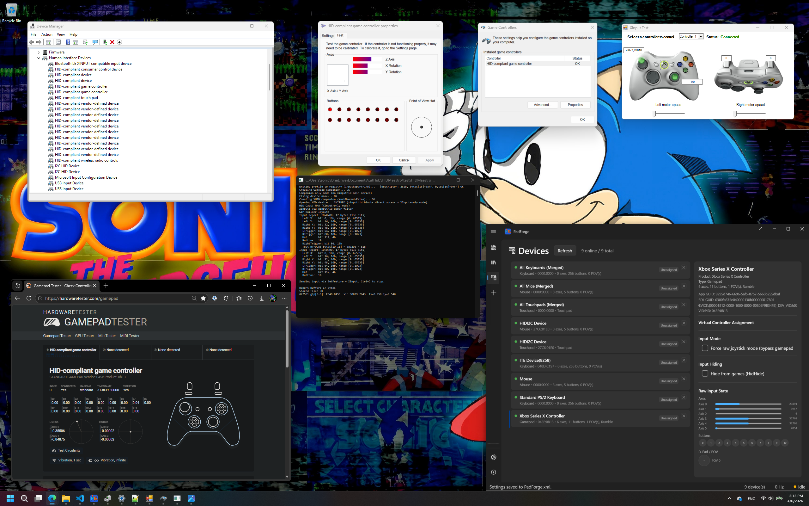
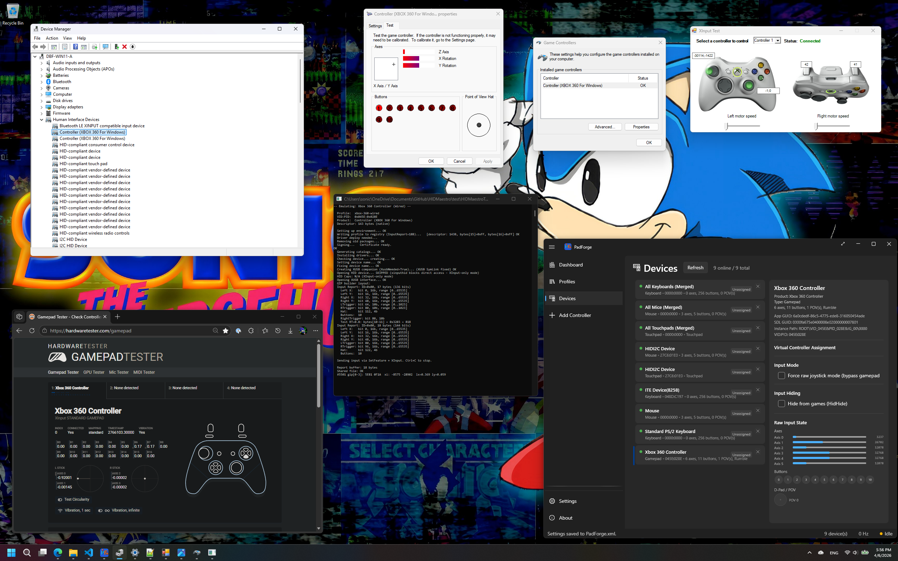
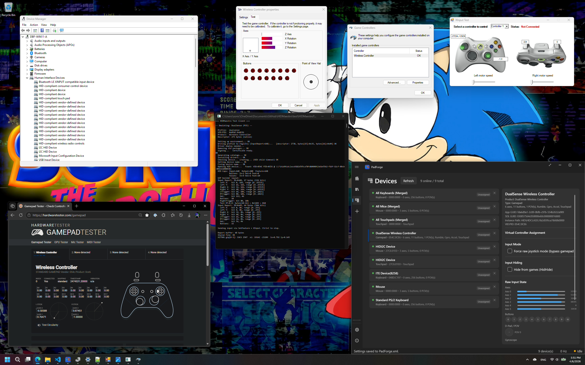
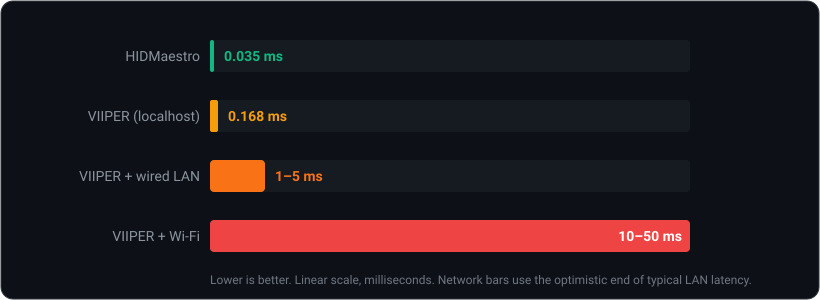

<p align="center">
  <picture>
    <source media="(prefers-color-scheme: dark)" srcset="docs/logo-light.png">
    <source media="(prefers-color-scheme: light)" srcset="docs/logo.png">
    
  </picture>
</p>

<h1 align="center">HIDMaestro</h1>

*"And we talk of Christ, we rejoice in Christ, we preach of Christ, we prophesy of Christ, and we write according to our prophecies, that our children may know to what source they may look for a remission of their sins."* 2 Nephi 25:26

*Glory, honor, and praise to the Lord Jesus Christ, the source of all truth and salvation, forever and ever.*

*You are warmly invited to visit [ComeUntoChrist.org](https://www.comeuntochrist.org) and learn more about Him and The Church of Jesus Christ of Latter-day Saints.*

---

<p align="center">
  <a href="https://somsubhra.github.io/github-release-stats/?username=hifihedgehog&repository=HIDMaestro"></a>
  <a href="https://discord.gg/qawTZHVhNH"></a>
  <a href="https://hidmaestro.org/"></a>
  <a href="https://hidmaestro.org/docs/"></a>
  <a href="https://github.com/hifihedgehog"></a>
  <a href="https://x.com/hifihedgehog"></a>
</p>

**Virtual game controllers, keyboards and mice that look like real hardware to Windows. No kernel driver. No network. No reboot.**

HIDMaestro creates virtual controllers that present the exact identity of real hardware across the whole Windows input stack at once. Pick from 336 built-in profiles, 103 of them keyboards and mice, or point it at a device you own and clone it. DirectInput, XInput, SDL3, the browser Gamepad API, and WGI/GameInput all see the VID/PID, product name, HID descriptor, axis and button layout, and bus type the profile defines. A virtual keyboard or mouse reaches Raw Input and the desktop as the device it copies.

It runs entirely in user mode (UMDF2), signed with a locally trusted self-signed certificate. No EV certificate, no `testsigning` boot mode, no kernel driver that can blue-screen the machine.

<p align="center"><b>336</b> device profiles · <b>20+</b> projects shipping it · <b>~35 µs</b> median single-press · <b>0</b> kernel drivers</p>

```csharp
using var ctx = new HMContext();
ctx.LoadDefaultProfiles();
ctx.InstallDriver();
using var ctrl = ctx.CreateController(ctx.GetProfile("xbox-360-wired")!);
ctrl.SubmitState(new HMGamepadState { Buttons = HMButton.A });
```

---

## Quick start

Requirements: Visual Studio 2022+ with the MSVC x64 and ARM64 build tools, Windows SDK/WDK 10.0.26100.0, .NET 10. Runs on x64 and ARM64 Windows. `HIDMaestro.Core.dll` is one AnyCPU assembly that carries a driver payload for each and picks the one matching the machine it is on.

As of v1.13.0 the SDK also runs in NativeAOT, trimmed and single-file apps. Profiles load through source-generated JSON, every Win32 call goes through `LibraryImport`, and the trim, single-file and AOT analyzers fail a Release build on any warning. A source build can leave out the ARM64 payload (`HMSkipArm64`) or the USB/IP transport (`HMSkipUsbip`), and can point at a NuGet WDK or at the variables an EWDK prompt sets. `HMBuildInfo` reports what a build carries, and a build without the USB/IP transport refuses a composite persona before it touches the machine. [Build settings](#build-settings).

```bash
# Build the native driver + companion for x64 and ARM64, then the SDK (idempotent).
scripts\build_all.cmd

# Minimal SDK consumer
dotnet run --project example\SdkDemo

# Full test app: cert + build + sign + install all automatic, requires elevation
cd test
dotnet build
bin\Release\net10.0-windows10.0.26100.0\win-x64\HIDMaestroTest.exe emulate xbox-360-wired

# Several controllers at once, any mix of profiles
HIDMaestroTest.exe emulate xbox-series-xs-bt xbox-360-wired dualsense

# List or search the 336 profiles
HIDMaestroTest.exe list
HIDMaestroTest.exe search thrustmaster

# Measure input latency
HIDMaestroTest.exe latency xbox-360-wired

# Validate every API (XInput, DirectInput, HIDAPI/SDL3, browser, WGI, HID order)
python scripts\verify.py --controllers 4
```

The test app is self-contained. First run creates a locally trusted certificate, extracts and signs the driver, installs it, creates the controllers, and starts feeding a test pattern. One console window, no popups, requires administrator.

During emulation you can `remove 2` to dispose one controller, `2 dualsense` to live-swap controller 2, or `quit` to shut down cleanly.

If you want to use HIDMaestro through a UI instead of code, install [PadForge](https://padforge.org/). It wraps this SDK with a full input-mapping app.

### Build settings

`scripts\build_all.cmd` builds everything an official release carries: the UMDF2 driver, XUSB companion and SWD helper for x64 and ARM64, the OpenVR driver, and the SDK with both usbip-win2 installers. Each setting below is an environment variable, which MSBuild reads as a property, so one setting reaches the native scripts and the SDK project alike. Each also works as `-p:` on a `dotnet build` of the SDK.

| Setting | Effect | Default |
|--|--|--|
| `HMSkipArm64=true` | Builds and embeds the x64 driver, companion and helper only, and leaves out the ARM64 usbip-win2 installer. | unset |
| `HMSkipUsbip=true` | Leaves out the USB/IP transport: both installers and the host controller files. Nothing is downloaded, hashed or unpacked for it. | unset |
| `HM_SDK_ROOT` | The Windows SDK: the `um` and `shared` headers, the `um` libraries, `rc.exe` and the signtool set the SDK embeds. | `WindowsSdkDir` when a Visual Studio or EWDK prompt set it, otherwise `%ProgramFiles(x86)%\Windows Kits\10` |
| `HM_WDK_ROOT` | The WDK: the `km` headers, the UMDF 2.15 headers and stub library, and Inf2Cat. | `WDKContentRoot` when an EWDK prompt set it, otherwise `HM_SDK_ROOT` |
| `HM_WDK_ROOT_ARM64` | The WDK for the ARM64 build. | `HM_WDK_ROOT` |
| `HM_WDK_VERSION` | The kits' version folder. | `Version_Number` when an EWDK prompt set it, otherwise `10.0.26100.0` |
| `HMWdkBin` | The folder whose `x64` and `arm64` folders hold the signtool set. | `HM_SDK_ROOT\bin\<version>\` |
| `HMInf2catBin` | The folder whose `x86` folder holds Inf2Cat. | `HM_WDK_ROOT\bin\<version>\` |

Installed kits need no setting. With the NuGet WDK, `HM_WDK_ROOT` is the `c` folder of `Microsoft.Windows.WDK.x64` and `HM_WDK_ROOT_ARM64` the `c` folder of `Microsoft.Windows.WDK.ARM64`, because each package carries the UMDF stub library for its own architecture only. The Windows SDK still comes from an installed kit, which Visual Studio's C++ workload installs. `HM_SDK_ROOT` cannot point at the SDK's own NuGet packages, which lay out libraries as `c\um\<arch>`. In an EWDK build prompt the defaults pick up the image's kit, version and Build Tools. The EWDK layout is read from the variables its prompt sets and has not been run. The scripts find Visual Studio through `VSINSTALLDIR` when a prompt set it, and otherwise search `%ProgramFiles%\Microsoft Visual Studio`. A root missing the folders the build reads stops the build with an error that names the setting.

`HMBuildInfo` reports what a built `HIDMaestro.Core.dll` carries: `DriverArchitectures`, `UsbipArchitectures`, `HasOpenVrDriver` and `IsComplete`. Each is read once from the assembly's own resource names, so it describes the bytes embedded, whatever settings built it. A controller that needs a payload the build lacks for the machine's architecture throws `HMPayloadMissingException`, derived from `InvalidOperationException`, before any machine-wide step. `InstallDriver`, `InstallUsbipBackend` and `HMVR.EnsureDriverRegistered` throw it too, and `IsUsbipBackendAvailable` is false in a build without the transport. Official releases stay complete: `pre-tag-validate.cmd` clears `HMSkipArm64` and `HMSkipUsbip` before it builds, and `check_build_layouts.ps1` builds every layout above before the battery runs.

---

## Who ships it.

Twenty-plus independent open-source projects have adopted HIDMaestro, across six languages, for a combined installed base of about 574,000 downloads as of September 2026. Roughly 27,700 of those builds ship or fetch the runtime directly.

### PadForge

[PadForge](https://padforge.org/) is the flagship implementation. It is built on this SDK end to end and drives more of the surface than any other consumer: every profile family, live profile swapping, multi-controller slots, force feedback, controller audio and haptics, the Valve personas, and the virtual VR controllers. Its Softpedia listing is an Editor's Pick at 5.0 out of 5.

To watch the SDK work without writing any code, install PadForge. If you are building your own app, it is the worked example of what this SDK does at full stretch.

### Everyone else

| Project | What it does with HIDMaestro |
|--|--|
| [foundation-sunshine](https://github.com/AlkaidLab/foundation-sunshine) | Sunshine fork. Its DualSense support is built on HIDMaestro |
| [JoystickGremlinEx](https://github.com/muchimi/JoystickGremlinEx) | Flight-sim remapper. Drives the SDK from Python over pythonnet |
| [Nearcade](https://github.com/TheRealFame/Nearcade) | Remote-play bridge. Pins the SDK as a submodule |
| [dualsense-command](https://github.com/shiftedx/dualsense-command) | Bundles the runtime in its bridge installers |
| [DirectXInput](https://github.com/dumbie/DirectXInput) | Ships the runtime with its controller tooling |
| [FlexInput](https://github.com/x-iso/FlexInput) | Uses HIDMaestro as its default virtual-device backend |

LizardByte's [libvirtualhid](https://github.com/LizardByte/libvirtualhid), from the organization behind Sunshine, reuses this project's force-feedback descriptor byte for byte and says so in its own source:

> HIDMaestro's MIT-licensed `MinimumViablePidFfbBlock`, byte-for-byte. The complete Output report set is required for DirectInput to enumerate the device as PID force-feedback capable.

Their header also describes the layout as "the constant-force and sine-periodic subset of the PID descriptor proven by HIDMaestro", and their alternatives table lists HIDMaestro beside ViGEmBus, inputtino and WinUHid.

---

## Identity: exact hardware, down to the bus.

VID/PID, product string, descriptor, axis and button layout, and bus type all match the real device. A Bluetooth controller reports as Bluetooth, not as a USB device wearing its name.

- **Exact hardware identity.** VID/PID, product string, HID descriptor, axis and button counts, trigger behavior, and bus type all come from the profile. SDL3's controller database matches it, Steam recognizes it, Chrome identifies it, joy.cpl shows the right name. A Bluetooth controller reports as Bluetooth, not as a USB device wearing its name.
- **Devices are JSON, not hardcoded.** Add a controller by writing a data-only JSON profile or by capturing one you already own. No per-device source code, no recompile, no hardcoded device classes. A device that carries several controllers in one report, and the commands it answers, are data too: the Wii U GameCube adapter's four ports and its command protocol are its profile, run by mechanisms any profile can use.
- **Data-driven profiles.** Every controller is a JSON file. Adding support for a new one means writing JSON, not modifying code.
- **Sony pads answer the whole startup interrogation.** A game with native PlayStation support interrogates a DualSense before it will use it: firmware info, pairing info, then motion calibration. Serve a plausible-looking blob of zeros to any of them and the pad is refused, which is why a virtual controller can work in Steam Input and still be invisible to the game. Calibration is a divisor, so zeros make the consumer's sensitivity NaN. Firmware info is validated on content, and a real title abandons the device and retries every 500 ms on a zeroed reply, before it ever asks for calibration. HIDMaestro serves real payloads for all of them on both the UMDF2 and composite backends, byte-identical between them, with every field offset checked against the Linux `hid-playstation` driver and a second independent consumer. The calibration is the identity for the pads' own units, so a submitted 1 g reads as 1 g in SDL and Linux, and the Bluetooth profiles end those replies with the CRC-32 a real pad sends over Bluetooth, which Linux and RPCS3 check.
- **Where hardware revisions disagree, the current one wins.** A DualSense made in 2020 reports the product string `Wireless Controller`. A DualSense made today reports `DualSense Wireless Controller`. Both report `bcdDevice` 0x0100, so nothing on the wire distinguishes them and a profile can only serve one. As of v1.4.5 `dualsense` and `dualsense-composite` serve the current string, because a consumer keyed to the launch string is already broken against real modern hardware. The launch string stays reachable on `dualsense-bt`, whose `dualsense-bt-full` sibling carries the current one.
- **The same device on every life.** A virtual controller keeps its device paths, container id and USB serial across a dispose and recreate, a process restart, a reboot and a driver upgrade, so a program that stored a binding against the path or the serial keeps it. Pass an identity key that means something to you, or pass none and the controller index is the key:

  ```csharp
  using var pad = ctx.CreateController(profile, "slot0");   // same paths every time
  ```

  Every family is covered: plain HID parents take an explicit instance id with the child's `ParentIdPrefix` written before registration, the Xbox families take a fixed software-device tuple, and the composite personas serve a serial derived from the key. A different profile at the same key keeps the identity and refreshes the descriptor. Verified by a battery that measures parent, child, interface path, DirectInput GUID, SDL3 path and USB serial across nine lives per family. [How this works](docs/INTERNALS.md#stable-device-identity-across-lives).
- **Protocol controllers, not just passive HID.** The Nintendo Switch Pro Controller is not a passive device: hosts drive a Nintendo subcommand handshake and stall without a device that answers. HIDMaestro's driver answers it over the real Bluetooth wire (the shipped descriptor is extracted byte-exact from a live Pro's SDP cache): SPI calibration reads, input-mode switch, 60 Hz full-mode streaming with gyro and accel at the 49-byte Bluetooth report size. SDL3's HIDAPI driver and Steam Input bind it as a real Bluetooth Pro Controller with motion and rumble. Before any protocol host arrives, the pad streams genuine 12-byte 0x3F simple-mode frames, the one report DirectInput can parse, so joy.cpl reads a working controller in exactly the states real hardware allows.
- **Pressure-sensitive buttons for PS3 emulators.** The `dualshock-3-full` persona is a DualShock 3 in the form Sony's sixaxis.sys driver and DsHidMini's SXS mode present on Windows, which is where PCSX2 and RPCS3 read button pressure. The face buttons, shoulder buttons and d-pad directions each take a pressure from 0 to 255 (`HMGamepadState.PressureA` through `PressureDpadLeft`), and L2 and R2 take theirs from the triggers. A pressed button left at pressure 0 reads fully pressed, so code that only knows digital state still works. Motion and battery ride the same report, and rumble and the player LEDs come back on `OutputDecoded`. Stock SDL, configured the way PCSX2 configures it, reads every axis and pressure back, and RPCS3's reads and writes replayed against the persona decode correctly. Neither emulator has been run against it yet.

### Custom controllers

The `HidDescriptorBuilder`, `HMProfileBuilder`, and `HMDeviceExtractor` APIs let you build or modify any device:

- **Clone and modify.** Take a DualSense (15 buttons) and ship a 16-button variant. Windows, Steam, and games still see "DualSense" because the VID/PID and product string are preserved.
- **Build from scratch.** Define a flight stick, racing wheel, or arcade panel with arbitrary VID/PID, axis count, button count, and resolution. No hex editing.
- **Capture a real device.** `HMDeviceExtractor.Extract` reads the HID descriptor Windows parsed from any device you have plugged in and returns a ready-to-deploy profile. Point it at the controller, get a matching virtual.

```csharp
// Clone a DualSense and add a button
var custom = new HMProfileBuilder()
    .FromProfile(ctx.GetProfile("dualsense")!)
    .Id("dualsense-16btn")
    .Descriptor(new HidDescriptorBuilder()
        .Gamepad()
        .AddStick("Left", 8).AddStick("Right", 8)
        .AddTrigger("Left", 8).AddTrigger("Right", 8)
        .AddButtons(16).AddHat()
        .Build())
    .InputReportSize(9)
    .Build();
using var ctrl = ctx.CreateController(custom);
```

Adding a controller to HIDMaestro is a data change. Adding one to a code-per-device emulator means writing and compiling a new device implementation. That difference is the whole point of the profile system.

## Keyboards and mice.

As of v1.12.0 a profile can be a keyboard or a mouse. The catalog has 51 keyboards and 52 mice from 32 vendors, each the report descriptor of a real device's keyboard or mouse interface, taken from public dumps. Windows treats them as it treats the hardware: Raw Input lists each one as its kind, a Scroll Lock pressed on a virtual keyboard turns Scroll Lock on, and the mouse moves the cursor.

```csharp
using var mouse = ctx.CreateController(ctx.GetProfile("logitech-g502-hero")!, "mouse-1");
mouse.SubmitMouse(new HMMouseState { X = 25, Y = -10, Buttons = HMMouseButtons.Left });
mouse.SubmitMouse(new HMMouseState());

using var keyboard = ctx.CreateController(ctx.GetProfile("keychron-q6")!);
keyboard.SubmitKeyboard(HMKeyModifiers.LeftShift, new[] { HMKey.A });
keyboard.SubmitKeyboard(HMKeyModifiers.None, ReadOnlySpan<HMKey>.Empty);
```

- **Every report arrives.** A gamepad reports state, so only the newest report matters. A mouse reports movement, which adds up, and a keyboard reports presses and releases, which must all arrive. For keyboards and mice the driver confirms each report Windows has taken, and the SDK sends the next only after that, at most one per millisecond, as a full-speed USB device would. A burst of 600 one-count moves lost nothing, and neither did four mice driven from four threads at 250 Hz each. With every core busy, four mice each sending as fast as the SDK allows, one report a millisecond, delivered every report, in order.
- **The descriptor decides the layout.** `SubmitMouse`, `SubmitKeyboard` and `SubmitConsumer` pack into whatever reports the profile declares, with or without report IDs. A movement larger than the descriptor's field is split across reports.
- **Buttons past five.** Raw Input's mouse report carries five buttons. A mouse built with `HidDescriptorBuilder.VendorButtons` gets a second collection for the rest, which Raw Input lists as a HID device of its own.
- **Absolute pointers.** `HidDescriptorBuilder.Mouse(absolute: true)` builds a pointer that takes 0 to 32767 and reaches Raw Input flagged `MOUSE_MOVE_ABSOLUTE`.
- **Keyboard LEDs.** Windows sends a keyboard its Num Lock, Caps Lock and Scroll Lock state when it arrives and on every change. `KeyboardLedsChanged` reports each change and `KeyboardLeds` holds the latest, including the state sent while `CreateController` was still running.
- **Stable paths.** Four mice with one VID and PID are four Raw Input devices, and each identity key gets the same device path back on every life.
- **Nothing stays held.** If the consuming process ends with a key or button down, however it ends, the driver lets go of it. Without that, Windows would repeat a held key until the device was removed. `Dispose` sends the same release first, and the next session's cleanup removes the devices a dead consumer left, keyboards included.

`HidDescriptorBuilder` builds them from scratch with the `Mouse`, `Keyboard`, `KeyboardNkro`, `ConsumerControl` and `VendorButtons` starters. Battery scenarios S69 and S70 check the descriptors and packers, then every catalog keyboard and mouse through Raw Input. [How this works](docs/INTERNALS.md#keyboards-and-mice).

---

## Programs side by side.

As of v1.13.0 two or more programs that embed HIDMaestro run on one machine without touching each other's controllers, drivers or files. Before this, every machine-wide name was keyed by a controller index that each program numbered for itself, so two programs that each created a first controller wrote the same sections and registry keys, and a driver deploy or a cleanup in one removed what the other was using.

### Claims and the transport index

A program takes an ownership claim before its first machine-wide write. The claim is a named pipe, `\\.\pipe\HIDMaestro.Owner.<id>`, created with `FILE_FLAG_FIRST_PIPE_INSTANCE` and one instance. A second claimant fails on the same call that would have won, and Windows deletes the pipe when the program ends, however it ends. A record under `HKLM\SOFTWARE\HIDMaestroOwners` names the program, its image path, its SDK version and its controllers, and stays until the program exits.

Each controller claims a transport index, `\\.\pipe\HIDMaestro.Index.<N>`, and an identity, `\\.\pipe\HIDMaestro.Identity.<token>`, for its life. The transport index names the controller's shared sections, events, owner pipe and registry key, and it is the `ControllerIndex` the driver reads. `CreateController` still numbers controllers by slot within a context. The transport index is the slot when no one else on the machine holds that number, and the lowest free number otherwise. A program running alone therefore gets the numbers it always got, and two programs that each create a first controller get indices 0 and 1. A number is free when its claim can be created, no v1.12.0 program holds its owner pipe, no present HIDMaestro device records it and no USB/IP import uses it.

`HMController.TransportIndex` is the number and `HMController.SectionNames` lists the names of the controller's sections. A native writer that opens the sections without the SDK reads the names there or computes them from `TransportIndex`. A keyless controller derives its identity from its transport index, so when another program holds index 0 it lands on another index and another identity. Pass an identity key for paths that stay the same between runs.

### Identity claims

Asking for an identity key that a running program holds throws `HMResourceInUseException`, derived from `InvalidOperationException`. Its message and its `OwnerProcessId`, `OwnerImagePath` and `OwnerSdkVersion` name the holder, and the holder's devices see no PnP activity. The check covers two contexts in one process too. A v1.12.0 program takes no identity claim, so when a present device carries the identity, the create probes that device's owner pipe and refuses the same way while it is held. A create is also refused when a device with the same `ParentIdPrefix` belongs to a running program or to an owner the SDK cannot determine, because the SDK never lets two parents share a prefix. The message names the device. For a device whose owner cannot be determined it also names the cleanup call that removes it.

### Sweeps and cleanup

A sweep removes a device only on proof that its owner is gone. The SDK reads the records and the present HIDMaestro devices and decides who owns what. A device in a record whose claim is gone is removed. A device in a live record is left alone, the caller's own included. A device with no record is judged by v1.12.0's signs: while its owner pipe is held its program is running, and with the pipe gone and the `Global\HIDMaestroInputAck<N>` section its driver keeps still present, its program has exited and the device is removed. A device with neither sign came from a program older than v1.12.0, which leaves no trace of whether it still runs, so no sweep removes it on a guess. Only the `Everything` cleanup and a create that asks for that device's own identity key remove it. A USB/IP import is matched by the server port its program's record names, and an import whose port has no listener on loopback is detached.

`InstallDriver`, the session cleanup and `RemoveAllVirtualControllers()` act on the devices of exited programs only. `RemoveAllVirtualControllers(HMCleanupScope.Everything, preserveInstall)` removes every HIDMaestro device and import on the machine, whoever owns it, which is what `HIDMaestroTest cleanup` does. Driver packages are removed only while no other program runs and no device remains. A program that exits without disposing its controllers has them removed by the SDK's own exit handler. It waits at most 10 seconds for the program's phantom cleanup and for a create still in flight, then removes the devices to the end, as `Dispose` does. When that wait runs out, or a device does not leave, the devices stay in the program's record and stay present until a program built on this release next sweeps, and a killed program's devices go the same way. The wait runs out when a create of the program still holds on at 10 seconds, on another thread or waiting for another program's sweep, when one phantom uninstall of the cleanup lasts longer, or, under .NET, when a thread inside a create calls `Environment.Exit`. The records Windows keeps of removed devices go with a background cleanup once per process, started by the first of `InstallDriver`, the first create and `RemoveAllVirtualControllers()`. The call that starts it returns without waiting for it to end. While it runs, a create in the program and the `Everything` cleanup wait for it to end: one pass over the phantoms, their uninstalls, at most 5 seconds of waiting in all, for Windows to let them go and for the machine-wide lock that programs on this release hold while they register or remove a device, and two passes over interface registrations that wait for that lock within the same 5 seconds. When the process is already exiting, the call runs the cleanup itself before it returns, waiting at most 10 seconds for a create in flight to let it start. The SDK learns that the process is exiting from `AssemblyLoadContext.Default.Unloading`, which the runtime raises before `ProcessExit`. Under .NET it cannot learn it in a program in which no code that refers to the SDK ran or was compiled before exit began, such as one that uses the SDK only inside its own exit handler, and the cleanup then ends with the process. A later call removes none, and the next process's first cleanup removes what is left. A context dropped without `Dispose` keeps its controllers, their transport indices and their identity keys until the process exits, so a create of one of those keys in the same process is refused until then.

### Driver install policy

Every driver deploy holds the machine-wide mutex `Global\HIDMaestro.Deploy` for one call and reads the installed state again once it has the mutex, so of two programs calling `InstallDriver` at once, one deploys and the other finds the driver current. A call that finds the installed driver already matching skips the mutex. The installed version is the newest `DriverVer` among the `hidmaestro.inf` packages in the driver store, compared by release version, then build date, then build number. `HMContext.LastDriverInstall` reports what `InstallDriver` did:

| Installed driver | Outcome |
|--|--|
| none | `Installed` |
| this SDK's | `AlreadyCurrent` |
| newer | `KeptNewer`, never downgraded |
| older, no present device of any program on it | `Upgraded` |
| older, devices of running or unknown programs on it, driver from v1.12.0 or later | `KeptInUse`, and this SDK runs on it |
| older, held the same way, driver older than v1.12.0 | `HMDriverVersionException` |

`HMDriverVersionException` derives from `InvalidOperationException` and carries `InstalledVersion`, `MinimumVersion` and `Blockers`, the devices and programs that hold the driver.

A UMDF2 `CreateController` checks the installed set under the same mutex, after its record entry and before its PnP work. When the installed-payload record is the one this process last confirmed, the check ends there. Otherwise it looks for a package of each of `hidmaestro.inf` and `hidmaestro_xusb.inf` in the driver store, of any stamp. When one is missing it applies the install policy above. At the installed driver's own stamp it adds whichever of this build's packages is missing and removes nothing. With nothing on the driver it deploys in full, which removes older packages first, and with an older driver that no device holds it upgrades the same way. A program whose packages another program uninstalled therefore gets them back at its next create, and a create can wait for another program's deploy to finish. A composite create takes the same mutex for the usbip-win2 transport install instead. A create of a plain HID or non-xinputhid controller installs the driver on its own device with `DiInstallDevice`, which touches no other device, so a newer SDK no longer moves another program's controller of the same profile onto its own driver. `HMController.DriverVersion` reports the driver a controller runs on, read from a per-controller version section, `Global\HIDMaestroVersion<N>`, that the SDK and the driver both write.

### Staging

Everything the SDK runs elevated or hands to pnputil is staged per version and per operation under `%ProgramData%\HIDMaestro\Staging\<version>-<hash>\<operation>`. Each directory is created with a security descriptor that gives write access to Administrators and SYSTEM only. Before each use the SDK checks every directory on the path: no reparse point, owned by Administrators or SYSTEM, and no write right granted to anyone else. A version or operation directory that fails is moved aside to `<name>.untrusted-<guid>` and created again, and the two roots are reset in place. A file is written under a temporary name, checked against its embedded SHA-256 (the pinned release hash for the usbip-win2 files), renamed into place and checked again immediately before it runs. `hmswd.exe` always comes from the embedded resource. A deploy deletes the staging directory of every version that no running program's record names.

### Older SDKs

A program on v1.12.0 and a program on this release run side by side. This release judges the v1.12.0 program's liveness by its owner pipes, never removes its controllers while it runs, and runs on the v1.12.0 driver when that program's controllers hold it.

The other direction is not fixable from here. A v1.12.0 program, and every older one, calls `RemoveAllVirtualControllers(preserveInstall: true)` inside its `InstallDriver`, which removes every HIDMaestro device on the machine, and replaces the installed driver with its own whenever the payload differs. Starting one while a v1.13.0 program runs removes that program's controllers. Moving every program on the machine to v1.13.0 or later is the fix. A program older than v1.12.0 also blocks a driver upgrade while its devices are present, and when the installed driver predates v1.12.0, `InstallDriver` throws `HMDriverVersionException` naming them.

Battery scenario S71 runs programs side by side, with peers built on v1.12.0 and v1.11.0, and S72 checks the staging. [How this works](docs/design/v1.13.0.md).

---

## NativeAOT, trimmed and single-file apps.

As of v1.13.0 `HIDMaestro.Core` publishes as NativeAOT and as a trimmed single-file app, for x64 and ARM64. Profiles and layouts load through `HMJsonContext`, a source-generated `JsonSerializerContext` with no reflection behind it, and every Win32 declaration is `LibraryImport`. `hmswd.exe` comes from the embedded resource and never from beside the assembly, whose location is empty in a single-file app. The project sets `IsAotCompatible`, and the trim, single-file and AOT analyzers report as errors in a Release build.

`HMLayoutJsonOptions.Default` is now the source-generated context's options, so it is read-only and reads and writes the SDK's own types only. Code that changed a setting on it throws `InvalidOperationException`. Copy it with `new JsonSerializerOptions(HMLayoutJsonOptions.Default)` to change a copy.

Battery scenarios S74 and S75 publish one app four ways, NativeAOT and trimmed single-file for x64 and ARM64, and run the two for the machine's architecture. Each app loads the catalog, installs the driver, creates `dualshock-4-v2` on the UMDF2 driver and `dualsense-composite` on USB/IP, submits input, waits for an output report and disposes. S76 requires the source-generated parse to read every embedded profile to the same contents as v1.12.0's reflection-based parse. At v1.12.0 both kinds of app load 0 of 336 profiles, because reflection-based JSON is off in them.

Process start to catalog loaded, 30 runs on the devbox:

| | p50 | p95 |
|--|--|--|
| JIT | 168.4 ms | 174.1 ms |
| NativeAOT | 17.0 ms | 17.9 ms |
| Trimmed single-file | 345.6 ms | 350.4 ms |

Trimming drops the framework's precompiled code, which is why the trimmed single-file app starts slowest.

---

## Every API at once.

DirectInput, XInput, SDL3, the browser Gamepad API, and WGI/GameInput all see one correct device.

- **One device, every API.** DirectInput sees correct axes and buttons. XInput sees separate triggers in one slot. SDL3/HIDAPI sees the right identity and bus type. The browser sees a STANDARD GAMEPAD with separate triggers. WGI sees one Gamepad. [How this works](docs/INTERNALS.md#techniques).
- **Multiple controllers at once.** No hard limit. Verified with 6 mixed controllers, correct per-controller ordering across all APIs. XInput caps Xbox-family profiles at its own 4 slots.
- **Force feedback.** HID PID 1.0 answers for DirectInput FFB games, plus rumble/haptic output events the consumer routes to real hardware.
- **Hot-plug.** Create and remove controllers with no reboot. Live-swap a controller's profile mid-session. Warm single-controller create is ~200 ms.
- **A throwing handler stays contained.** An exception a handler throws on one of the SDK's own threads is dropped and the next handler runs. The nine events covered are `OutputReceived`, `OutputDecoded` and `KeyboardLedsChanged`, a port's `OutputChanged`, the USB audio events and `HapticReceived`. Set `HIDMAESTRO_DIAG=1` to log each dropped exception.
- **Validated across every API and both ends of the spectrum.** A 70-scenario regression battery checks DirectInput, XInput, SDL3/HIDAPI, the browser Gamepad API, WGI and Raw Input on every change. It runs on a 16-core Windows 11 laptop, with the latest results under the battery below, and the 57-scenario v1.7.3 battery also passed on a low-power Intel Atom Windows 10 fixture.

### Validation

Tested on Windows 11 IoT Enterprise LTSC 2024 (build 26200) and Windows 10 IoT Enterprise LTSC (build 19044), with a self-signed certificate in the machine's Root and TrustedPublisher stores and no test-signing boot mode. Every profile is checked across all the input APIs a game can reach: DirectInput (joy.cpl and DirectInput8), XInput, SDL3/HIDAPI, the Chrome Gamepad API, WGI/GameInput, and HID enumeration order, through `scripts/verify.py` plus manual verification. A real Xbox Series X|S Bluetooth controller tested side by side shows byte-identical behavior across the HID class APIs.

| Profile | DirectInput | XInput | SDL3 | Browser | WGI |
|--|--|--|--|--|--|
| Xbox 360 Wired | 5 axes, 10 btns | 1 slot, separate triggers | &IG_ path, USB | STANDARD GAMEPAD | 1 entry |
| Xbox Series BT | 5 axes, 16 btns | 1 slot, separate triggers | &IG_ path, Bluetooth | STANDARD GAMEPAD | 1 entry |
| DualSense (PS5) | 6 axes, 15 btns | N/A | USB | Detected | N/A |
| 6-controller mixed | All 6 visible | 4 slots (XInput cap) | 4 IG + 2 live | 4 pads (Chrome cap) | All 6 visible |

The Xbox Series BT row shows 16 buttons because Windows' `xinputhid` synthesizes a 16-button layout over the 12-button source descriptor. [Details](docs/INTERNALS.md#validation-results).

A 70-scenario [live-swap regression battery](test/regression/swap_regression.ps1) drives every create / swap / remove / force-kill sequence, the FFB round-trip, the Sony vendor-blob encode/decode, the composite USB personas end to end through the real USB stack, the battery reply a pad gives XInput, the device identity of every family across nine lives, the driver catalog for both architectures, the 2026 Steam Controller persona against Steam's own firmware updater, the DualShock 3 and 4 reports against SDL, Linux and RPCS3, the Switch 2 Pro Controller persona against a capture of a real pad, SDL and the Steam client, the registry keys a virtual shares with real devices, what WGI reads from a virtual pad, and every keyboard and mouse through Raw Input, verifying no PnP devnodes are left behind. On a 16-core AMD Ryzen 9 Windows 11 laptop the v1.12.0 release build passed all 70 scenarios. The 57-scenario v1.7.3 battery also passed 57/57 on a 4-core Intel Atom Z8350 Windows 10 fixture, the low end of the performance and OS spectrum.

Full device-tree dumps, HIDAPI enumeration logs, per-profile results, and startup/teardown timing are in [docs/INTERNALS.md](docs/INTERNALS.md#validation-results).

<details>
<summary><b>Xbox Series X|S BT, Xbox 360 Wired, and DualSense across Device Manager, joy.cpl, Chrome Gamepad Tester, and PadForge/SDL3</b></summary>





</details>

---

## Latency: lower, measured.

- **Lower latency, measured.** ~35 µs median single-press, more than 4x faster than the closest alternative, with no batching cap on input. Output (rumble, FFB, LED) is event-driven as of #34: ~0.15 ms median from the game's write to the consumer callback, down from the 9.4 ms poll-quantized path, and idle controllers cost zero measurable CPU.
- **No network in the path.** Input travels through shared memory on the same machine. There is no socket, no USBIP stack, and no kernel transport driver between your application and the device.
- **Fast to start, fast to recover.** When the installed driver already matches, `InstallDriver()` completes in ~40-60 ms and a consumer goes from process start to a live controller in about a second. If the consuming app is force-closed mid-session, the next launch evicts the orphaned devices and has the first controller live again in ~2.3 s, measured with an Xbox Series BT profile in the mix (the deepest teardown stack).

Measured input latency from `SubmitState` to the input surfacing through XInput, single button press, 10,000 iterations on the same host:

| | Single-press latency |
|--|--|
| **HIDMaestro** (measured) | **~35 µs median, worst case under 1 ms** |
| VIIPER (their published Windows figure) | 168 µs |

Reproduce it yourself: `HIDMaestroTest.exe latency xbox-360-wired`. The harness shares one clock between the writer and the reader and detects the actual button bit changing, so the number is real propagation, not poll quantization. Full methodology and per-run numbers: [docs/testing/latency.md](docs/testing/latency.md).

HIDMaestro talks to its driver through a shared-memory section on the same machine. There is no socket and no network stack in the path. Both directions are event-driven: each `SubmitState` signals the driver immediately with no fixed batching interval, and the driver signals each captured output packet (rumble, FFB, LED) back to the consumer at ~0.15 ms median instead of the pre-#34 8 ms poll. Idle controllers cost zero measurable CPU. Output methodology and before/after numbers: [docs/testing/latency.md](docs/testing/latency.md).



The network bars above use the optimistic end of each LAN range. Even granting VIIPER the best case, its Wi-Fi path is hundreds of times longer than HIDMaestro's shared-memory path.

<details>
<summary><b>A note on the comparison, and the layering question</b></summary>

A note on the comparison. VIIPER is "Virtual Input **over IP**", built on USBIP and driven over a TCP API or an in-process library. Its sub-millisecond figures are measured over **localhost only**. Its own benchmark doc says so plainly: "remote/network USBIP attachment will add network RTT and jitter which is intentionally excluded from these baseline figures." Round-trip time there is how long an input takes to travel to another machine and come back, and jitter is how much that delay varies from moment to moment. The headline latency excludes the network path the project is named for, and VIIPER batches reports every millisecond, capping the update rate at 1000 Hz.

The moment you run it over an actual network, that excluded round-trip time dominates: roughly 1 to 5 ms added over wired LAN, and 10 to 50 ms over Wi-Fi, on top of the localhost figure rather than instead of it. That is one to two orders of magnitude above the sub-millisecond number the docs lead with, and the caveat that explains the gap is a single line buried in a testing doc. Anyone who reads "well below 1 millisecond" and pictures networked play is being pointed at the wrong number.

There is also a layering question worth naming. Networking is a transport concern that belongs in the application, not in the virtual-device driver. Building USBIP-over-IP into the emulator puts a kernel USBIP driver and a listening socket in front of every user, including the ones who only ever drive a controller on the same machine. HIDMaestro keeps the device layer local: the SDK writes input to a shared-memory section, and nothing in the driver knows or cares whether that input came from the local process or was relayed by the consumer from another machine. If you want input over a network, that is the application's job to own and secure, without dragging a network stack and a kernel transport driver through every local use of the device. Consumers already do this at the right layer: PadForge, built on HIDMaestro, shares controllers across PCs over a network with its Remote Link feature (added in 3.4.0), both directions with feedback returning to the real device, with zero latency added for anyone playing locally.

And there is the matter of what USBIP can represent at all. USB/IP transports USB, so every device VIIPER creates is a USB device to Windows. The controllers people actually use often are not: an Xbox or DualSense paired over Bluetooth enumerates as a Bluetooth device, and SDL3 and Chromium parse it through different code paths because of that bus type. A USB-only emulation reports the wrong bus for those controllers. HIDMaestro sets bus type per profile, so a Bluetooth controller presents as Bluetooth (HIDAPI reports `bus_type = Bluetooth`), matching the hardware it stands in for.

</details>

---

## Nothing in the kernel.

- **No kernel driver, no test-signing.** Pure user-mode UMDF2, loaded by a locally trusted self-signed certificate. No test-signing boot mode, no purchased certificate, no reboot, and a bug cannot blue-screen the machine. It installs on an ordinary user's PC, not just a developer box.
- **No kernel driver.** UMDF2 runs the driver in a normal user-mode process. A bug cannot blue-screen the machine. Self-signed certificate trusted by the local machine is enough.

### How it works

HIDMaestro is a UMDF2 HID minidriver hosted by Windows' own `mshidumdf.sys`, fed input through a per-controller shared-memory section. XInput for Xbox profiles comes from a companion device that registers the XUSB interface. Bluetooth identity, the &IG_ enumerator behavior, the separate-trigger descriptor trick, the WGI admission path, and the XInput slot allocator are all documented in [docs/INTERNALS.md](docs/INTERNALS.md).

Why user mode is enough: the HID class driver already lives in the kernel (`mshidumdf.sys`), XInput discovery uses a device interface a user-mode driver can register, GameInput reads HID reports rather than driver internals, and bus type and VID/PID are settable from user mode. See [Why UMDF2 Is Enough](docs/INTERNALS.md#why-umdf2-is-enough).

---

## Controller audio and haptics: composite USB personas

A real USB DualSense is a four-interface composite: USB Audio Class speaker/haptics out, microphone in, and HID. UMDF2 can present exactly one HID interface, so the standard `dualsense` profile stops there. As of v1.4.0 three additional profiles present the full composite. They are the ones named **Full** in a profile picker, which is the catalog's marker for the most capable profile of a given device:

- **`dualsense-composite`**: the real pad's four interfaces, byte-for-byte from a hardware descriptor dump. The OUT stream is 4-channel 48 kHz where channels 1/2 are the speaker and channels 3/4 drive the voice-coil actuators. That stream is the only path on Windows by which a game hands a controller its authored haptic waveforms, and it surfaces on the SDK as `HMController.UsbAudio.Output` with per-channel roles. The microphone is `UsbAudio.Microphone`: feed PCM, Windows records it from a real "Headset Microphone (Wireless Controller)" endpoint.
- **`dualsense-edge-composite`**: the Edge's four interfaces from a physical Edge's full USB probe. Same speaker/haptics stream and microphone as the base pad, the Edge's own 389-byte HID descriptor, and the Edge's real 1 ms USB input polling.
- **`dualshock-4-v2-composite`**: the DS4 v2's composite, with headset audio and a mono microphone. The hardware has no haptics lane.

The original DS4 v1 (054C:05C4) has no composite variant for a reason worth stating: real hardware probes show it presents a single HID interface over USB with no audio class at all. USB audio arrived with the v2.

A composite persona is a real Sony pad at every level a filter can inspect, which is what the audio class driver requires and is not negotiable. That leaves a host with nothing of its own to recognize, so the emulated host controller these personas sit behind carries a second hardware ID, `ROOT\HIDMAESTRO_UDE`, alongside its upstream one. An application that already excludes its own virtual pads by looking for `HIDMAESTRO` in a device's hardware IDs keeps working if it walks far enough up: from the persona's HID interface that node is four parents away. Nothing is added to the persona itself.

That same invisibility is why cleanup has to reach the personas by a different route. The device sweep behind `RemoveAllVirtualControllers` walks the ROOT and SWD enumerators for the `HIDMAESTRO` token, and a composite carries none, so before v1.4.5 a consumer that created one and exited left a USB DualSense enumerated on the machine with nothing left running to feed it. The sweep detaches personas from the emulated host controller first, then walks the enumerators. As of v1.13.0 it detaches only the personas of programs that have exited, and `RemoveAllVirtualControllers(HMCleanupScope.Everything, preserveInstall)` detaches every one.

```csharp
using var ctrl = ctx.CreateController(ctx.GetProfile("dualsense-composite")!);
ctrl.UsbAudio!.Output.FramesReceived += (out_, pcm) => { /* speaker + haptic PCM */ };
ctrl.UsbAudio.Microphone.Submit(micPcm);
```

That is the whole setup. Composite personas create like any other profile, because the USB transport they need ships **inside `HIDMaestro.Core.dll`** and installs itself the first time one is created, exactly the way the UMDF2 driver already does. No second package, no separate download, nothing for a user to go find. The bundled component is [usbip-win2](https://github.com/vadimgrn/usbip-win2) 0.9.8.1, BSD-2-Clause, with Microsoft-signed drivers for x64 and ARM64, redistributed unmodified with its notice, and checked against its pinned SHA-256 both when the SDK is built and again before it is ever executed. The x64 installer is the 0.9.8.1 release asset. The ARM64 installer is the same tag's build from the project's signing service, posted in [usbip-win2#13](https://github.com/vadimgrn/usbip-win2/issues/13). A machine that HIDMaestro itself put on an older usbip-win2, 0.9.7.7 through v1.8.1 or 0.9.7.5 in v1.9.0 and v1.9.1, is moved to 0.9.8.1 automatically: the SDK replaces the host controller driver through Windows' own driver update, leaves the root-hub filter alone so no USB device drops, and does it only in a Windows session where nothing has used the controller yet. Until such a session comes, the older transport keeps working. Any other usbip-win2 version was put there by another program and is left as it is. The SDK speaks the request layouts of 0.9.7.x, 0.9.8.0 and 0.9.8.1 and asks the driver which one it has. Set `HIDMAESTRO_KEEP_TRANSPORT=1` to keep the older transport. Windows re-enumerates the USB root hubs once during that one-time install, so devices blink for a moment on the very first composite controller a machine ever creates.

The bundled installer runs only where no copy of usbip-win2 is installed, with the smallest set it allows: `/VERYSILENT /SUPPRESSMSGBOXES /NORESTART /COMPONENTS=main,client /TASKS=vcredist /NOICONS`. That installs the root-hub filter and host controller drivers and the Visual C++ runtime they need, and no GUI, SDK headers, PDB files, Start menu folder or shortcut. `usbip.exe`, `devnode.exe`, `libusbip.dll`, an uninstaller and its scheduled task stay on the machine, since the installer has no switch to leave them out. A machine counts as having a copy when the driver store holds its package or an uninstall entry for it exists in the 64-bit or 32-bit view of HKLM or in HKCU and its uninstaller file is still there, because the installer would run that copy's uninstaller first. The install and the move to 0.9.8.1 hold the deploy mutex, so two programs whose first composites arrive together find one host controller after one installer run.

Every device behavior stays in HIDMaestro's own user-mode code: the SDK runs an in-process USB/IP device server on loopback, including the 1 ms isochronous audio pacing. 0.9.8.1 is the first release with the fix for the attach work item that blocked driver unload in 0.9.8.0 ([usbip-win2#188](https://github.com/vadimgrn/usbip-win2/pull/188)).

Measured on the Atom Z8350 floor machine: full 4-channel render and live microphone capture through `usbaudio.sys` with no frame starvation, attach in ~316 ms, and idle cost with the transport installed but no device attached indistinguishable from baseline (0.35% vs 0.24% CPU). The composite path runs as scenario S45 of the battery, so a broken persona fails the release gate like anything else.

### Valve-recognized Steam devices

The same machinery answers a different problem. The plain `steam-deck` and `steam-controller` profiles carry Valve's real ids over standard gamepad descriptors, so Steam files them under Generic DirectInput and none of Steam Input's Valve-device treatment applies: no gyro lane, no trackpads, no HD haptics, no Valve button prompts. Recognition follows the device a real unit presents, not the ids alone. Three personas present those devices.

`steam-deck-composite` (28DE:1205) reproduces a real unit's whole USB identity from its `lsusb` dump, because that identity is what Steam inspects: `bcdDevice` 3.00, product string `Steam Controller`, a serial string, `wTotalLength` 150 and five interfaces: mouse on 0, keyboard on 1, the vendor-page controller on 2, then an Interface Association Descriptor and the CDC ACM pair on 3 and 4. Input is the 64-byte Neptune frame (`ID_CONTROLLER_DECK_STATE`, header `01 00 09 40`), packed from `SteamDeckStatePacket_t` and cross-checked against a 25,000-frame capture of real hardware.

`steam-controller-composite` (28DE:1102) is the wired 2015 controller. Every descriptor is verbatim from a real unit: the device and configuration blobs, the 63-byte keyboard and 56-byte mouse report descriptors its lizard mode drives, and the 33-byte vendor-page controller descriptor. Three interfaces, because SDL binds the pad only on interface 2. Its frame is `ValveControllerStatePacket_t`; the pad has one stick and no separate stick field, so with the finger-down bit clear `sLeftPadX/Y` is the joystick, which is how the hardware reports it.

`steam-controller-2` (28DE:1302) is the 2026 controller, the one SDL calls Triton. One HID interface addressing everything by report id, with the 372-byte descriptor and the attribute values Steam validates taken from two independent reads of real hardware. The one exception is the firmware build: with Steam installed it reports the build Steam's own updater ships, as a real unit does once it takes that update, so Steam never offers the persona an update it cannot install. Its frame is the 54-byte `TritonMTUFull_t` on report `0x42`.

All three answer the `GET_REPORT` interrogation Steam performs before it will claim a device. Like the hardware, each reports on its own clock whether or not the consumer has anything new to send: every 4 ms for the Deck and the 2026 controller, every 8 ms for the 2015 one. While the consumer is quiet, the persona repeats the consumer's last frame. All three are verified end to end by battery scenarios S51 and S52: S51 pins descriptors, endpoints and feature answers with no device; S52 creates each persona, drives it through `SubmitState` and through raw reports, reads the frames back off the real HID stack, and measures that clock.

### Nintendo Switch 2 Pro Controller with motion

`switch2-pro-controller-composite` (057E:2069) is the Pro Controller 2 as it appears over USB on firmware 1.1.5: HID on interface 0 and a vendor bulk pair on interface 1. Its device and configuration descriptors are a real pad's, byte for byte, from a link-layer capture of a console driving one. The plain `switch2-pro-controller` profile has the HID interface alone and streams report `0x09`, whose motion block no public source decodes. SDL's Switch 2 driver and Steam start the pad with commands on the second interface, then read report `0x05`, which carries the accelerometer and the gyro.

Windows binds WinUSB to interface 1 from the persona's own Microsoft OS 1.0 descriptors, so there is no INF to install and no Zadig step. Behind that interface the persona answers the pad's command protocol: the flash reads that return its serial and calibration, the feature mask, the report selection, the player LEDs. Like the pad, it sends nothing on its interrupt endpoint until a host sends the start command. From then on it sends one report every 4 ms on its own clock, whatever rate the consumer submits at.

`SubmitState` is this persona's whole input path. `AccelGX/GY/GZ` in g and `GyroDpsX/Y/Z` in degrees per second leave as the pad's raw counts in report `0x05`. SDL reads 1 g back as 9.807 m/s² and 100 deg/s as 1.745 rad/s, on the axis submitted and with its sign. The raw submit methods throw `NotSupportedException`, because the report that goes out and its counters belong to the device. A host's rumble arrives on `OutputDecoded` as `leftMotor` and `rightMotor`.

```csharp
using var pad = ctx.CreateController(ctx.GetProfile("switch2-pro-controller-composite")!);
pad.OutputDecoded += (_, e) => { /* e.Fields["leftMotor"], e.Fields["rightMotor"] */ };
pad.SubmitState(new HMGamepadState { AccelGY = 1.0f, GyroDpsX = 100f });
```

Only a host that speaks the command protocol gets input. On Windows that is Steam, and SDL where libusb is present. DirectInput, RawInput, WGI and browsers see a gamepad that never reports, as they do with a real pad, and `switch2-pro-controller` stays the profile for them. A bulk read that a host abandons comes back as success with stale bytes, and so do the reads after it, because usbip-win2 0.9.8.1 completes a canceled transfer without resetting its length. SDL and Steam read only after they send a command, so neither meets it. Headset audio, NFC, pairing, firmware update and the magnetometer are not emulated.

Battery scenario S65 checks the persona on the wire against the capture, through HidUsb and WinUSB, through PadForge's SDL3 fork with libusb, as two pads at once, and through the Steam client, which adds it as a Nintendo Switch Pro Controller and takes its 250 reports a second.

### Wii U GameCube adapter for Dolphin and Slippi

`gamecube-adapter` (057E:0337) is Nintendo's WUP-028, the four-port adapter Melee players use, on the USB/IP transport. Its device, configuration, string and report descriptors match 57 public dumps of real units, except where those dumps differ among themselves: the control endpoint's packet size and the strings of seven units. Like the adapter, it sends nothing until a host writes 0x13, then reports all four ports in report 0x21 on every 8 ms poll, takes each port's rumble from 0x11, and answers 0x12, 0x14 and SET_PROTOCOL as the adapter does.

Dolphin, Slippi and SDL open the adapter through libusb, which needs WinUSB, and Windows binds its HID driver instead, which is why a real adapter needs Zadig. `BindWinUsb()` binds WinUSB to this one virtual adapter's devnode and installs it nowhere else. HIDMaestro never changes the driver of a devnode that is present, so the binding outlasts the controller on that devnode for as long as an adapter sits on it. It is a trade, and it can reach a real adapter. A real WUP-028 can take the devnode's instance (the first adapter of that serial gets the same instance) while the virtual one is gone, its connection down or its controller disposed, and it then opens on WinUSB, as after Zadig, until it is unplugged. Once the devnode is gone, it is marked to install Windows' HID driver at its next arrival by the first of these: a HIDMaestro program disposing a controller, its cleanup (`RemoveAllVirtualControllers`), its reclaim of the controllers of a program that has ended, a binding that moves to the devnode a dropped adapter came back on, or the follow-up that watches the devnode for five minutes after its holder lets go. A program that only runs does none of them unless its own adapter drops and comes back, so an adapter unplugged after the follow-up has ended and plugged in again before any of them happens comes back on WinUSB. A real adapter that arrives while the virtual one is bound gets its own instance and the driver Windows gives it. For a WUP-028, Windows' HID driver fails with Code 10 and libusb hosts need WinUSB, so the lingering state is the one many owners pick with Zadig on purpose.

```csharp
using var adapter = ctx.CreateController(ctx.GetProfile("gamecube-adapter")!);
adapter.BindWinUsb();
adapter.Ports[0].SubmitState(new HMGamepadState { Buttons = HMButton.A });   // port 1
adapter.Ports[2].Connect("wireless");                                          // a WaveBird on port 3
adapter.Ports[1].OutputChanged += (_, e) => { /* "rumble": 0 stop, 1 run, 2 stop hard */ };
```

Each port has its own connection (wired, wireless or empty), its own input and its own rumble, and keeps its number when a controller leaves and returns. `Ports.Flags["rumblePower"]` is the second USB cable. L and R report their analog travel on the triggers and their clicks as `HMButton.LeftTriggerClick` and `RightTriggerClick`. The ports, the status values, the commands and their replies are the profile's JSON, which the SDK compiles at create.

Dolphin's and Slippi's own adapter code, compiled unmodified, reads all four ports, and so does SDL 3.4.18 built with libusb. The official SDL3 build for Windows has no libusb and lists no adapter, real or virtual. A port submit reaches Dolphin in 4.8 ms at p50 on the adapter's 8 ms poll, and in 1.5 ms when the host polls every millisecond, as Melee players overclock it, at 832 reports a second against a real adapter's 833. Battery scenarios S79 to S83 check the bytes, the protocol, the binding, Dolphin, Slippi and SDL.

## Virtual VR controllers

A VR controller is not an OS device: games ask the VR runtime "where is the left hand, and what is its trigger doing." So this subsystem is a native OpenVR driver that SteamVR's own vrserver loads, embedded in `HIDMaestro.Core.dll` and registered with one call. One driver covers native OpenVR games and OpenXR games running on SteamVR, which is the default PCVR configuration.

```csharp
HMVR.EnsureDriverRegistered();          // one-time, content-hash idempotent
using var vr = new HMVRController();    // both hands appear in SteamVR
vr.SubmitState(in state);               // buttons, trigger/grip, stick, optional full pose - per frame
vr.HapticReceived += (_, e) => ...;     // every haptic pulse a VR app plays, with hand attribution
var head = vr.GetHmdPose();             // the real headset pose, for head-as-input mapping
```

The hands hold real SteamVR hand roles, serve the modern input system through a full input profile, and serve legacy `GetControllerState` readers through a shipped legacy binding. Controllers exist only while a consumer is live, so an idle machine shows no phantom devices. SteamVR is the one dependency, and it installs Steam-client-free and account-free via Valve's own `steamcmd +login anonymous +app_update 250820`. The whole loop is machine-verified on headless rigs with no headset (battery scenario S50): enumeration, roles, input, haptics, and a 90 Hz legacy state stream read back through Valve's own client API. [Full docs](https://hidmaestro.org/docs/sdk/vr-controllers/).

---

## How it compares

<details>
<summary><b>Tool by tool</b></summary>

| | HIDMaestro | VIIPER | ViGEmBus | vJoy | WinUHid |
|--|--|--|--|--|--|
| Kernel driver required | **No** (UMDF2 user mode) | Yes (USBIP) | Yes | Yes | No (UMDF2 on VHF) |
| Installs without test-signing mode | **Yes** | Yes | Yes | Yes | No (ships test-signed) |
| EV certificate for new builds | **No** | No (uses signed usbip-win2) | Yes ($300+/yr) | Yes | No (OV cert for x64) |
| Network play | **App layer via consumers (PadForge Remote Link), zero local penalty** | In the driver: +1-5 ms wired, +10-50 ms Wi-Fi | No | No | No |
| Identity per controller | **Exact, 336 profiles** | 6 fixed device types | 2 fixed types | Fixed "vJoy Device" | 4 presets, or raw descriptor |
| Bus type fidelity | **Per-profile, incl. Bluetooth** | USB only (USBIP) | USB only | USB only | USB only |
| Add a new device | **JSON file, or capture one you own** | Write Go (a few hundred lines/device) | N/A | N/A | Write C, or raw descriptor |
| Local single-press latency | **~35 µs measured** | 168 µs published (localhost) | N/A | N/A | Not published |
| Input update rate | Event-driven, no fixed cap | 1000 Hz (1 ms batching) | N/A | N/A | Event-driven |
| License | MIT | GPL-3.0 (clients MIT) | N/A | N/A | MIT |
| Status | **Active** | Active | Retired | Stale | Active |

</details>

VIIPER describes itself as running entirely in userspace. On Windows that holds only for its device code: the USB/IP transport is a third-party kernel-mode driver, and VIIPER makes you go install it. HIDMaestro's own driver is user-mode UMDF2, and it rides the host that already ships with Windows, so the "no kernel driver" row above is literal for everything the standard profiles do. The composite USB personas are the one deliberate exception, and they use the same signed usbip-win2 transport VIIPER does, because a Windows audio endpoint requires a driver-backed USB device and no user-mode API can create one. The difference is what the user has to do about it: HIDMaestro ships that transport inside its own DLL and deploys it on demand, so a composite persona is a profile you pick, not a prerequisite you chase. Use any other profile and no kernel-mode component is ever installed.

HIDMaestro is Windows optimized and focused on game controllers, keyboards, mice and other HID game devices. Within that scope it gives you exact hardware identity with no kernel driver, no network layer, and no per-device code. That combination is what HIDMaestro is built for, and nothing else on this list delivers it.

### What it replaces

- **VIIPER**: needs a kernel-mode USB/IP driver on Windows despite the userspace billing, makes the user install it, and presents every controller as USB so Bluetooth devices report the wrong bus type. Its headline latency is localhost-only and already 4 to 5 times higher than HIDMaestro's even there. The network it is named for adds another 1 to 50 ms on top.
- **vJoy**: kernel driver, no longer actively maintained, shows up as "vJoy Device" instead of real hardware.
- **ViGEmBus**: kernel driver, retired, new builds need an EV code-signing certificate.
- **DsHidMini**: user-mode, but translates a physically connected DualShock 3 rather than arbitrary input.

---

## Known Limitations

- **Windows optimized.** HIDMaestro is built on UMDF2, `mshidumdf`, and the Windows HID/XInput/WGI stack. There is no Linux or macOS build.
- **Output is delivered, not routed to hardware.** The driver accepts rumble/haptic/FFB writes and raises `OutputReceived` to the consumer. Sending those to a physical controller is the consumer's job (PadForge does this).
- **Auth-chip controllers.** PS4/PS5 online and Nintendo Switch Online require cryptographic authentication from real controller hardware. HIDMaestro cannot replicate authentication chips.
- **Vendor-specific feature reports.** LED control, calibration, and firmware-update reports vary per device and need per-controller work.
- **One interface per keyboard or mouse.** A keyboard or mouse profile carries the descriptor of the real device's keyboard or mouse interface. Its other interfaces, including the ones vendor configuration tools use, are not emulated.
- **Anti-cheat.** Virtual devices are detectable by kernel-level anti-cheat. HIDMaestro does not hide that it is virtual.
- **Older SDKs side by side.** A program built on HIDMaestro 1.12.0 or older removes every HIDMaestro device on the machine when it calls `InstallDriver`, another program's included. Programs on 1.13.0 or later leave each other's devices alone.

## Security and Scope

HIDMaestro replicates the public-facing identity and input/output behavior of game controllers. It does **not** replicate cryptographic authentication, implement vendor-private protocols unless a profile adds them, bypass anti-cheat, or modify data from physical controllers.

## Credits

- **[DsHidMini](https://github.com/nefarius/DsHidMini)** by [Nefarius Software Solutions](https://nefarius.at/). HIDMaestro builds on the UMDF2 + xinputhid approach Nefarius pioneered in DsHidMini, which demonstrated that a user-mode driver framework can replace kernel-mode drivers for controller emulation on Windows. The `mshidumdf` HID proxy, `WUDFRd` reflector, and xinputhid XInput bridge are the foundation of HIDMaestro's stack. The `dualshock-3-full` persona reproduces the report descriptor DsHidMini presents in its SXS mode and derives that mode's reports the way DsHidMini does, under its BSD 3-Clause license ([notice](sdk/HIDMaestro.Core/THIRD-PARTY-NOTICES.txt)).
- **[HIDAPI](https://github.com/libusb/hidapi)**: bus-type detection behavior informed the BTHLEDEVICE spoofing technique.
- **[SDL3](https://github.com/libsdl-org/SDL)**: multi-backend fallback behavior informed the &IG_ enumerator trick. SDL3 is not a dependency. HIDMaestro is validated against it.

## Donations

**There is no tip jar.** Knowing HIDMaestro is useful is reward enough. If you insist on giving something, give it to a charity instead and bless humanity. Short of one you already trust, [Humanitarian Services of The Church of Jesus Christ of Latter-day Saints](https://philanthropies.churchofjesuschrist.org/humanitarian-services) puts it to work directly, and [give.org](https://give.org) grades charities against twenty standards if you would rather choose your own. The upstream projects listed above have earned it as much as anyone. They made all of this possible.

Anonymously, preferably. Not at all is fine too, and nothing here changes either way.

**My promise:** HIDMaestro will never become paid, freemium, or Patreon early-access paywalled. Free means free.

## License

MIT License. See [LICENSE](LICENSE) for details.
